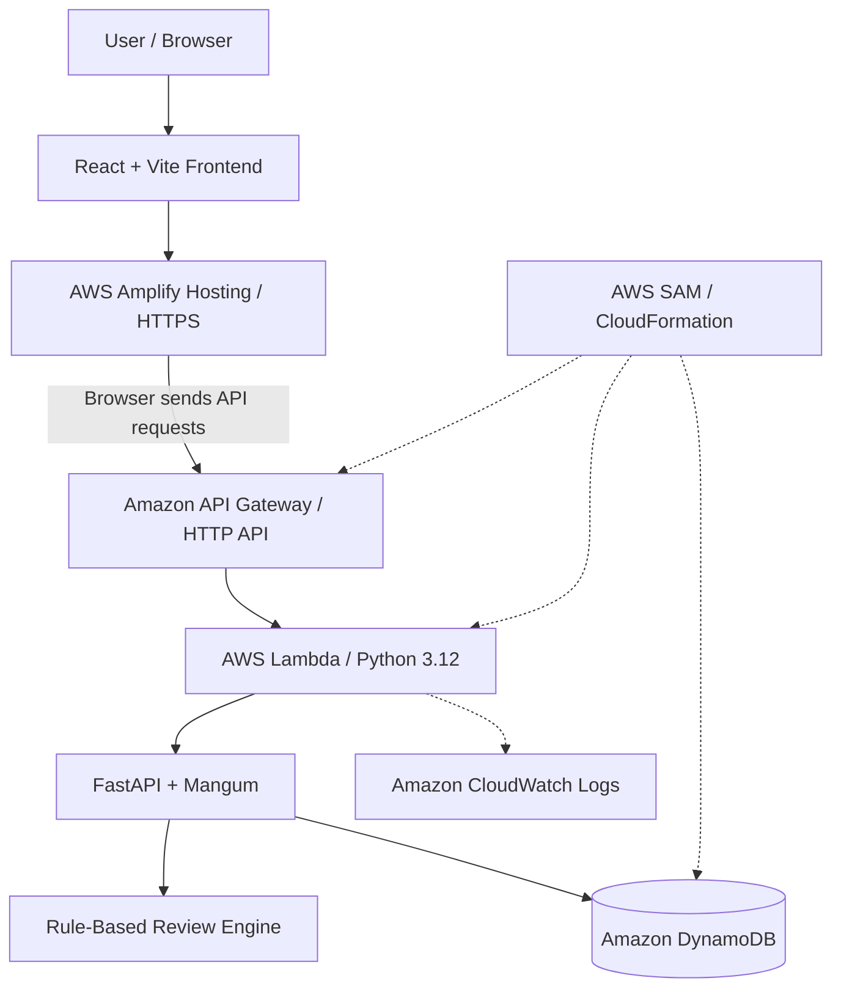

<div align="center">

# 🛡️ CodeGuard

### Cloud-Native Automated Code Review Platform

**Analyze source code · Explore findings · Track reviews · Understand code quality**

[](https://aws.amazon.com/)
[](https://react.dev/)
[](https://fastapi.tiangolo.com/)
[](https://www.python.org/)
[](https://aws.amazon.com/dynamodb/)
[](#rule-based-analysis-and-limitations)
[](#live-application)

**[🚀 Live Demo](https://main.d72rx55ohyqrt.amplifyapp.com)** · **[🔌 API Health](https://fm503w4luf.execute-api.ap-south-1.amazonaws.com/health)** · **[📁 Source Repository](https://github.com/DiyaJabin/codeguard-ai)**

*BCSE355L — Cloud Architecture Design Mini Project*

> **Repository naming:** Public-facing project name is **CodeGuard**. The GitHub repository, AWS stack, Lambda, and DynamoDB resources may still carry the previous `codeguard-ai` identifiers; these do not need to be renamed for the application to work.

</div>

---

## Overview

**CodeGuard** is a serverless, AWS-deployed developer tool that reviews Python and Java code for a focused set of potential code-quality, reliability, and security issues. Users can paste code or select a source file, view line-specific findings and suggested improvements, and explore saved reviews through a dashboard with history and analytics.

Its principal goal is to demonstrate a complete **frontend → API → serverless compute → cloud database** architecture using managed AWS services. The deployed review engine uses **deterministic, rule-based source-text checks**. It is not powered by a machine-learning or generative AI model. Amazon Bedrock remains disabled. The internal provider is named `MockReviewProvider` for compatibility with the existing codebase.

## Live application

| Component | Address |
| --- | --- |
| **Frontend — AWS Amplify Hosting** | **https://main.d72rx55ohyqrt.amplifyapp.com** |
| **Backend — Amazon API Gateway** | https://fm503w4luf.execute-api.ap-south-1.amazonaws.com |
| **Health check** | https://fm503w4luf.execute-api.ap-south-1.amazonaws.com/health |
| **AWS Region** | `ap-south-1` (Mumbai) |

> **Demo and privacy notice:** The reviewed implementation does not include authentication or user-specific authorization. The API should be treated as a public demonstration endpoint, **not** a secure place to submit proprietary code, credentials, or personal data. Please avoid excessive requests; AWS usage may incur charges.

## Features

- **Python and Java reviews** — paste source code, choose a language, or load a local `.py` / `.java` file into the editor.
- **Structured review findings** — titles, severity, category, affected lines, explanations, and recommendations.
- **Review history** — persist, browse, open, and delete submitted review reports.
- **Dashboard and analytics** — review totals, issue counts, severity breakdowns, language distribution, and issue categories.
- **Responsive interface** — dark/light appearance and developer-oriented workspace.
- **Cloud persistence** — DynamoDB stores review data in the deployed environment.
- **Rule-based review engine** — identifies selected syntax and style patterns without compiling or executing submitted code.
- **Safety-oriented analysis** — submitted source code is inspected as text, **never executed**.

> Some UI elements in the current repository are display-only or incomplete (for example, the history search input). Automated browser-level tests are not yet included.

## Cloud architecture



**How a review works:**

1. The user enters Python or Java code in the React frontend hosted on Amplify.
2. The browser makes an HTTPS request to API Gateway.
3. API Gateway routes the request to AWS Lambda; **Mangum** adapts the request to the **FastAPI** ASGI application.
4. The rule-based review provider (`MockReviewProvider` in the code) applies deterministic code-pattern checks and returns structured findings.
5. The repository layer converts Python `float` values to DynamoDB-compatible `Decimal` values and persists the review in DynamoDB.
6. The API returns JSON to the frontend, which displays the findings. History and analytics subsequently read saved data from DynamoDB.

### Why each AWS service?

| AWS component | Purpose |
| --- | --- |
| **Amplify Hosting** | Hosts and serves the built React frontend over HTTPS. |
| **API Gateway HTTP API** | Exposes HTTPS API endpoints and forwards requests to Lambda. |
| **AWS Lambda** | Runs the Python backend on demand without managing a server. |
| **Amazon DynamoDB** | Managed NoSQL persistence for review reports and statistics. |
| **CloudWatch Logs** | Captures Lambda runtime logs for diagnostics. |
| **AWS SAM / CloudFormation** | Defines and deploys repeatable serverless backend infrastructure. |
| **Amazon S3** | Used during the frontend hosting/deployment preparation; the user-facing site is hosted with Amplify. |

### Cloud concepts demonstrated

**Serverless computing**, **managed services**, **API-based decoupling**, **stateless compute with persistent storage**, **elastic service scaling**, **infrastructure as code**, and **usage-based billing**. These characteristics are provided by the architecture; this repository does not contain production load-testing results or measured scalability benchmarks.

## Technology stack

| Layer | Technology |
| --- | --- |
| Frontend | React, TypeScript, Vite, CSS, Lucide icons |
| Backend | Python 3.12, FastAPI, Pydantic |
| Lambda integration | Mangum |
| Cloud data | DynamoDB, boto3 |
| Legacy/local database files | SQLite / SQLAlchemy (local repository path currently not wired into review routes) |
| Analysis | Deterministic Python/Java source-pattern checks (`MockReviewProvider`) |
| Infrastructure | AWS SAM, CloudFormation, API Gateway HTTP API, Lambda |
| Hosting | AWS Amplify Hosting |
| Testing | pytest / FastAPI TestClient (limited backend tests) |

## API endpoints

Base URL: `https://fm503w4luf.execute-api.ap-south-1.amazonaws.com`

| Method | Route | Description |
| --- | --- | --- |
| `GET` | `/health` | Service status and configured environment/provider |
| `GET` | `/api/config` | Non-secret application configuration |
| `POST` | `/api/reviews` | Analyze a JSON code submission and save a report |
| `POST` | `/api/reviews/upload` | Upload a supported Python or Java text file (100 KB maximum) |
| `GET` | `/api/reviews` | Paginated history with optional search/severity filters |
| `GET` | `/api/reviews/{review_id}` | Retrieve a single report |
| `DELETE` | `/api/reviews/{review_id}` | Delete a report |
| `GET` | `/api/stats` | Aggregate review statistics |

Example JSON body for `POST /api/reviews`:

```json
{
  "language": "Python",
  "filename": "example.py",
  "code": "def add_item(item, items=[]):\n    items.append(item)\n    return items"
}
```

The application accepts **Python** and **Java** and validates a maximum submitted code size of **100 KiB**. Do not submit real passwords, private tokens, or confidential code to the public demo.

## Rule-based analysis and limitations

The current `MockReviewProvider` recognizes a limited set of source-text patterns, including:

- Python bare `except:` blocks and mutable default arguments.
- Java empty `catch` blocks and direct `System.out.println` usage.
- Credential-like assignments in either supported language.

The application may label these results **demo analysis** and should be interpreted as suggestions, not verified vulnerabilities or comprehensive static analysis. The engine does **not** compile or execute submitted code and does not provide comprehensive program analysis. **Amazon Bedrock integration is a disabled placeholder**; the project does not currently perform generative AI inference. The word “mock” in internal class names denotes the development-time rule-based provider, not an external AI service.

## Running and developing the project

### Requirements

- Python 3.12 recommended (the AWS Lambda runtime uses 3.12)
- Node.js and npm
- Git
- For cloud-backed review operations: authorized AWS credentials and access to the **correct DynamoDB table**, or use the already deployed demo API

### Frontend (Windows PowerShell)

```powershell
git clone https://github.com/DiyaJabin/codeguard-ai.git
cd codeguard-ai\frontend
npm.cmd ci
npm.cmd run dev
```

Vite normally serves `http://localhost:5173`.

**Important:** In the current source, `frontend/src/main.tsx` contains a hardcoded URL pointing to the deployed API Gateway endpoint. Running the frontend locally therefore **still calls the live AWS backend** and may produce billable API/Lambda/DynamoDB usage. For an offline frontend, configure a local API target and restore local review persistence first.

Production build:

```powershell
npm.cmd run build
```

### Backend (developer setup)

From the repository root:

```powershell
python -m venv .venv
.\.venv\Scripts\Activate.ps1
pip install -r backend/requirements.txt
Copy-Item .env.example .env
uvicorn app.main:app --app-dir backend --reload
```

Backend API docs (locally): `http://localhost:8000/docs`.

**Current local limitation:** The uploaded `backend/app/api/routes.py` only uses the DynamoDB review repository when `APP_ENV=cloud`. With default local settings, review creation/history routes are **not functional** and can return an error. Local SQLite initialization still exists, but the local repository is not connected to those routes. The deployed AWS environment is the primary supported end-to-end review workflow at this stage.

To operate a local backend against AWS DynamoDB, use properly scoped AWS credentials and cloud environment settings; this involves real cloud usage and is not a zero-cost offline mode. Do not copy deployment secrets into `.env.example` or Git.

### Tests

```powershell
pytest backend/tests
cd frontend
npm.cmd run build
```

The repository has a small backend test suite and frontend build verification, **not** comprehensive UI/E2E or cloud integration tests. The existing backend tests may require updates because they were written for the earlier local SQLite workflow. Do not assume the above checks pass without running them in your environment.

## AWS deployment notes

The backend infrastructure is declared in [`infra/template.yaml`](infra/template.yaml). The CloudFormation stack is named `codeguard-ai` in AWS Region `ap-south-1`.

| Resource | Deployment name |
| --- | --- |
| CloudFormation stack | `codeguard-ai` |
| Lambda | `codeguard-ai-ReviewFunction-g5QJDLMLtVTC` |
| DynamoDB table | `codeguard-ai-ReviewsTable-1VDE5R7KLAVTJ` |
| CloudWatch log group | `/aws/lambda/codeguard-ai-ReviewFunction-g5QJDLMLtVTC` |

The teammate's AWS deployment work is recorded on branch [`aws-deployment`](https://github.com/DiyaJabin/codeguard-ai/tree/aws-deployment), commit [`ad4b0dc`](https://github.com/DiyaJabin/codeguard-ai/commit/ad4b0dc). Review branch state before merging or redeploying; avoid unintended resource changes.

During deployment, a manually created CloudFront distribution was blocked by AWS account-verification requirements, so **Amplify Hosting** was used for the frontend instead. No EC2, RDS, NAT Gateway, OpenSearch, or provisioned AI service was required.

**Security/cost notice:** The uploaded SAM template allows wildcard API Gateway CORS, and the backend does not implement authentication or per-user authorization. CORS does not replace access control. The demonstration API is not production-hardened. DynamoDB, Lambda, API Gateway, Amplify, and CloudWatch can all incur charges; set AWS Budgets alerts and review actual usage before extended testing. Budgets are not spending caps.

See [`docs/AWS_COST_SAFETY.md`](docs/AWS_COST_SAFETY.md), [`docs/AWS_DEPLOYMENT.md`](docs/AWS_DEPLOYMENT.md), and [`docs/AWS_TEARDOWN.md`](docs/AWS_TEARDOWN.md) for project guidance. Some older documentation describes the pre-deployment state and should be updated before being used as current deployment instructions.

## Project structure

```text
codeguard-ai/
├── backend/
│   ├── app/
│   │   ├── api/routes.py
│   │   ├── core/config.py
│   │   ├── providers/mock.py
│   │   ├── providers/bedrock.py
│   │   ├── repositories/reviews.py
│   │   └── main.py
│   ├── requirements.txt
│   └── tests/
├── frontend/
│   ├── src/main.tsx
│   ├── src/styles.css
│   └── package.json
├── infra/template.yaml
├── docs/
├── samples/
├── samconfig.toml
└── README.md
```

## Deployment challenges solved

**DynamoDB numeric conversion:** boto3/DynamoDB rejects ordinary Python `float` values during writes. The DynamoDB repository recursively converts floats to `Decimal` for storage, then converts DynamoDB `Decimal` objects to JSON-compatible `int`/`float` values when reading.

**CloudFront account restriction:** AWS prevented creation of a manually managed CloudFront distribution pending account verification. Amplify Hosting provided a practical AWS-managed HTTPS frontend option.

## Roadmap

- [ ] Add user authentication (e.g., Cognito JWT) and per-user review access controls.
- [ ] Restrict API Gateway CORS to the required frontend origin and remove wildcard settings.
- [ ] Restore fully offline SQLite-backed review routes for local development.
- [ ] Make the API base URL configurable through a Vite environment variable.
- [ ] Add browser E2E testing and AWS integration tests.
- [ ] Improve UI controls, error handling, and data pagination/search.
- [ ] Optionally add a separate AI-assisted provider later, **only after explicit model access, security, privacy, and cost review**.

## Educational context

Built as a **BCSE355L Cloud Architecture Design** mini-project, focused on understanding AWS managed services and end-to-end serverless deployment.

---

<div align="center">

**CodeGuard** · [Live Demo](https://main.d72rx55ohyqrt.amplifyapp.com) · [GitHub](https://github.com/DiyaJabin/codeguard-ai)

*Serverless code review with transparent, rule-based analysis.*

</div>
