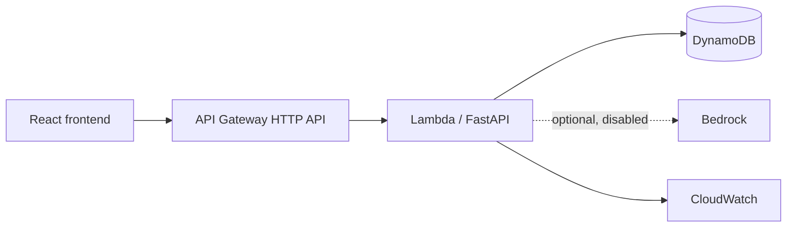

# Architecture

Local mode replaces API Gateway/Lambda/DynamoDB with localhost FastAPI and SQLite. The backend is stateless; the repository boundary keeps storage replaceable. IAM must be least privilege, Cognito should protect cloud endpoints, and CloudWatch retention should be short for a student demo.
